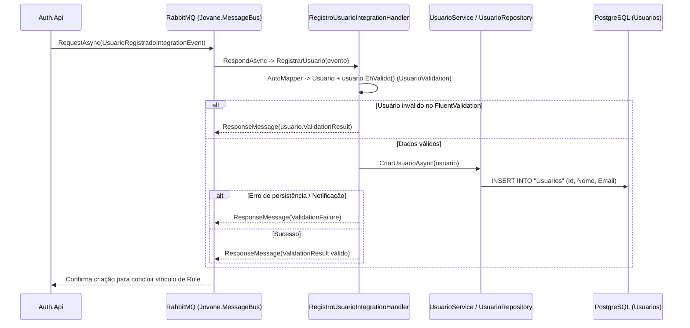
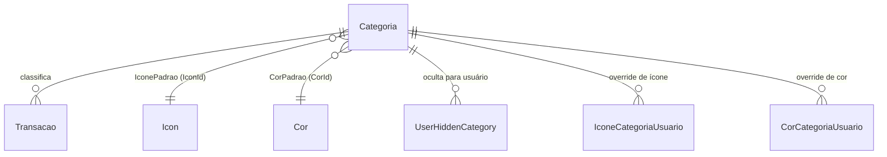
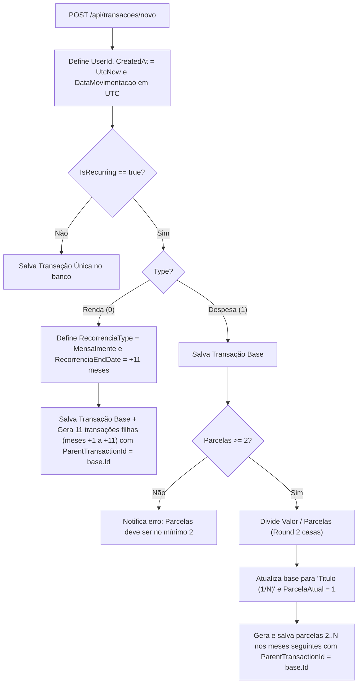

# Mapeamento de Fluxos e Arquitetura — Fin-API (`docs/flows.md`)

Este documento detalha os fluxos reais implementados na solution `fin-api.sln`, suas camadas, regras de negócio, modelos de dados e integrações externas.

---

## 1. Visão Arquitetural

```mermaid
flowchart LR
    Front["FinControl (React SPA)"] -->|JWT Bearer| Api["Fin.API (Controllers + JWKS)"]
    Smart["SmartApi (Java + Spring AI / Telegram)"] -->|JWT Bearer via OpenFeign| Api
    Auth["Auth.Api (.NET 10 IdP)"] <-->|JWKS Discovery (/jwks)| Api
    Auth -->|Request: UsuarioRegistradoIntegrationEvent| RMQ[(RabbitMQ / Jovane.MessageBus)]
    RMQ -->|Consumer: RegistroUsuarioIntegrationHandler| App["Fin.Application (Services)"]
    Api --> App
    App --> Infra["Fin.Infra (Repositories + EF Core)"]
    Infra --> PG[(PostgreSQL)]
```

### Padrão de Resposta HTTP (`MainController.CustomResponse`)
Todas as actions das controllers (`TransacoesController`, `CategoriesController`, `UsuarioController`) utilizam `CustomResponse(...)`:
- **Sucesso (`200 OK`):**
  ```json
  {
    "success": true,
    "data": { ... }
  }
  ```
- **Erro de validação ou regra de negócio (`400 Bad Request`):**
  ```json
  {
    "success": false,
    "errors": [
      "Mensagem de erro 1"
    ]
  }
  ```

---

## 2. Fluxo de Sincronização de Usuário via RabbitMQ

**Entry point:** `RegistroUsuarioIntegrationHandler` (`BackgroundService` em `Src/Fin.Application/Services/RegistroUsuarioIntegrationHandler.cs`)



- **Regra de Identidade:** O `Id` gerado no ASP.NET Identity da `Auth.Api` é preservado como chave primária na tabela `Usuarios` da `Fin-API`.

---

## 3. Fluxo de Categorias, Ícones e Cores (`/api/categories`)

**Entry point:** `CategoriesController` -> `CategoriaService` -> `CategoriaRepository`

### 3.1 Modelo de Categorias Padrão vs. Personalizadas
A `Fin-API` suporta categorias globais (`IsDefault = true`, compartilhadas entre todos os usuários) e categorias criadas pelo próprio usuário (`IsDefault = false`, `UserId = <id>`).



### 3.2 Operações Detalhadas

| Endpoint | Permissão | Comportamento e Regras de Negócio |
| :--- | :--- | :--- |
| `GET /api/categories` | `FIN:CTG_LER` | Busca todas as categorias onde `UserId == userId \|\| IsDefault`, incluindo `IconePadrao`, `CorPadrao` e overrides do usuário (`IconeCategoriaUsuarios`, `CorCategoriaUsuarios`). Filtra e remove as categorias padrão presentes em `UserHiddenCategories` para o usuário. |
| `GET /api/categories/{id}` | `FIN:CTG_LER` | Busca a categoria por ID com seus ícones/cores. Se `!IsDefault && UserId != userId`, bloqueia com notificação `"Você não tem acesso a essa categoria!"`. |
| `GET /api/categories/icones` | `FIN:CTG_LER` | Lista todos os ícones cadastrados na tabela `Icon` ordenados por `Name`. |
| `GET /api/categories/cores` | `FIN:CTG_LER` | Lista todas as cores cadastradas na tabela `Cor`. |
| `POST /api/categories` | `FIN:CTG_CRIAR` | 1. Verifica se já existe categoria (padrão ou do usuário) com o mesmo nome (`ExistsAsync`).<br>2. Se existir e **não** estiver oculta, notifica `"Categoria já existe para este usuário."`.<br>3. Se existir, for `IsDefault` e estiver oculta em `UserHiddenCategories`, remove a ocultação (`ShowHiddenCategory`) e retorna a categoria padrão reativada.<br>4. Caso contrário, cria nova categoria vinculada ao `userId`. |
| `PUT /api/categories/atualizar/{id}` | `FIN:CTG_CRIAR` | - **Se `IsDefault == true`:** proíbe alterar `Name` ou `Type` (`"Não é possivel atualizar o nome ou tipo de uma categoria padrão!"`). Permite personalizar `IconId` e/ou `CorId` substituindo os registros do usuário em `IconeCategoriaUsuarios` e `CorCategoriaUsuarios`.<br>- **Se `IsDefault == false`:** atualiza diretamente o registro em `Categories`. |
| `DELETE /api/categories/{id}` | `FIN:CTG_EXCLUIR` | 1. Valida existência e propriedade (`categoria.UserId != userId && categoria.UserId != null`).<br>2. Verifica se existem transações do usuário associadas à categoria; se houver, bloqueia (`"Não é possível deletar uma categoria associada a transações."`).<br>3. **Se `IsDefault == true`:** insere registro em `UserHiddenCategories` (`HiddenCategory`).<br>4. **Se `IsDefault == false`:** remove o registro da tabela `Categories` (`DeleteAsync`). |

---

## 4. Fluxo de Transações e Saldos (`/api/transacoes`)

**Entry point:** `TransacoesController` -> `TransactionService` (`TransacaoService.cs`) -> `TransacaoRepository`

### 4.1 Criação de Transação Única, Recorrente ou Parcelada (`POST /api/transacoes/novo`)

Permissão requerida: `FIN:TRN_CRIAR`.



> **Nota sobre o payload de entrada:**
> - Na branch `main`, o endpoint recebe `TransactionRequest` (`type`, `description`, `amount`, `categoryId`, `transactionDate`, `isRecurring`, `parcelas`) e converte para `Transacao` via `ToDomain()`.
> - Na branch `preview-prod`, o endpoint recebe `Transacao` diretamente (`type`, `titulo`, `valor`, `categoriaId`, `dataMovimentacao`, `isRecurring`, `parcelas`).

### 4.2 Atualização de Transação (`PUT /api/transacoes/{id}`)

Permissão requerida: `FIN:TRN_EDITAR`.

`TransactionService.UpdateTransactionAsync` valida se a transação pertence ao `userId` e trata 4 cenários:
1. **Era recorrente/parcelada e deixou de ser (`existente.IsRecurring && !dto.IsRecurring`):**
   - Executa `TransformaRecorrenciaEmUnica`: remove todas as transações filhas (`ParentTransactionId == existente.Id`), limpa metadados de recorrência e, caso fosse despesa parcelada (`Parcelas > 1`), recompõe o valor cheio (`Math.Round(existente.Valor * existente.Parcelas.Value, 2)`).
2. **Era única e passou a ser recorrente/parcelada (`!existente.IsRecurring && dto.IsRecurring`):**
   - Executa `TransformaEmRecorrente`: atualiza a transação base e gera as recorrências mensais (se `Renda`) ou parcelas (se `Despesa`).
3. **Continua recorrente/parcelada (`existente.IsRecurring && dto.IsRecurring`):**
   - Executa `AtualizarRecorrencia`: atualiza a base, remove todas as filhas anteriores (`RemoverRecorrencias`) e recria as 11 recorrências futuras (se `Renda`) ou as novas parcelas (se `Despesa`).
4. **Continua única (`!existente.IsRecurring && !dto.IsRecurring`):**
   - Atualiza `Titulo`, `Valor`, `CategoriaId` e `DataMovimentacao` (em UTC).

### 4.3 Exclusão de Transação (`DELETE /api/transacoes/{id}`)

Permissão requerida: `FIN:TRN_EXCLUIR`.
1. Busca a transação e valida se `existing.UserId == usuarioId`.
2. Se `existing.IsRecurring == true`, remove todas as transações filhas (`GetByParentTransactionId` -> `RemoveRangeAsync`).
3. Remove a transação principal.

### 4.4 Consultas de Transações, Saldo Total e Comparativo Mensal

| Endpoint | Permissão | Regra de Consulta |
| :--- | :--- | :--- |
| `GET /api/transacoes/saldo` | `FIN:TRN_LER` | Calcula o início do próximo mês em UTC (`new DateTime(now.Year, now.Month, 1).AddMonths(1).ToUniversalTime()`) e soma no banco todas as transações do usuário com `DataMovimentacao <= inicioProximoMes` (`+Valor` para `Renda`, `-Valor` para `Despesa`). Isso garante que parcelas ou recorrências de meses futuros não distorçam o saldo do mês atual. |
| `GET /api/transacoes/periodo` | `FIN:TRN_LER` | Requer `startDate` e `endDate` (`start <= end`). Converte para UTC cobrindo do início do `startDate` até o último tick do `endDate`, retorna transações ordenadas por `DataMovimentacao DESC` com `Categoria`, `Icone` (padrão + override) e `Cor` (padrão + override). |
| `GET /api/transacoes/saldo-mes` | `FIN:TRN_LER` | Requer `startDate` e `endDate` (`start <= end`). Agrupa transações do período por `{ Year, Month }` no PostgreSQL e retorna lista de `SaldoMensalDTO` (`Mes`, `Receita`, `Despesa`) ordenada cronologicamente. |
| `GET /api/transacoes/{id}` | `FIN:TRN_LER` | Retorna uma transação específica validando `transacao.UserId == userId`. |
| `GET /api/transacoes` | `[Authorize]` | Lista todas as transações do usuário autenticado. |
| `GET /api/transacoes/health` | `[AllowAnonymous]` | Health check simples que retorna `200 OK`. |

---

## 5. Fluxo de Perfil do Usuário (`/api/usuarios`)

- **`GET /api/usuarios`** (`[ClaimsAuthorize("permission", "FIN:TRN_LER")]`):
  - Extrai `UsuarioId` do token JWT via `IUser` (`MainController`).
  - Chama `UsuarioService.BuscarUsuarioPorIdAsync(UsuarioId)` -> `UsuarioRepository.GetUsuarioByIdAsync`.
  - Retorna `ResponseSuccessDTO<UsuarioDTO>` (`{ id, nome, email }`) ou `400 Bad Request` caso não encontrado.
