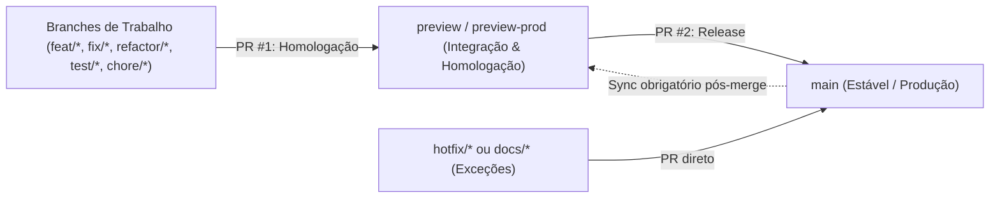

# Estratégia Git: Branches, Commits e Pull Requests — Fin-API (`docs/git-workflow.md`)

Este documento define o fluxo de versionamento da **Fin-API**, alinhado ao ecossistema (`Auth.Api` e `FinControl`) e otimizado para colaboração humana e **fluxo AI-First** (commits semânticos, rastreabilidade de contratos e Pull Requests padronizados).

---

## 1. Estratégia de Branches

O repositório utiliza **branches intermediárias** para isolar e homologar alterações antes da promoção para `main`:



### Estrutura e Regras
1. **`main` (Produção / Estável):**
   - Contém o código consolidado, testado e estável.
   - **Nunca** realizar commits diretos de funcionalidades na `main`.
   - Recebe merges via Pull Request a partir da branch intermediária (`preview` / `preview-prod`) ou de branches de exceção (`hotfix/*`, `docs/*`).
2. **`preview` / `preview-prod` (Branch Intermediária de Homologação):**
   - Concentra entregas parciais para validação integrada com o frontend (`fin`), `Auth.Api` e `SmartApi`.
   - **Importante:** Sempre manter sincronizada com a `main` após releases ou hotfixes para evitar divergência de arquitetura/contratos entre branches.
3. **Branches de Trabalho (`<tipo>/<descricao-kebab-case>`):**
   - Devem ser curtas, focadas em um único escopo e criadas a partir da branch base atualizada:
     - `feat/` — Nova funcionalidade ou endpoint (ex.: `feat/relatorio-categorias-periodo`)
     - `fix/` — Correção de bug (ex.: `fix/calculo-parcelas-despesa`)
     - `refactor/` — Melhoria interna de arquitetura/código sem quebrar contrato (ex.: `refactor/remover-automapper-transacoes`)
     - `test/` — Criação ou ampliação de testes unitários/integração (ex.: `test/categoria-service-overrides`)
     - `docs/` — Documentação técnica e guia AI-First (ex.: `docs/contexto-ai-first-e-fluxos`)
     - `chore/` — Atualização de pacotes NuGet, Dockerfile, configs (ex.: `chore/atualizar-messagebus`)
     - `hotfix/` — Correção crítica urgente em produção

### Ciclo de Vida Recomendado
1. Atualizar a branch base:
   ```powershell
   git checkout preview-prod # ou main/preview conforme o fluxo da entrega
   git pull
   ```
2. Criar a branch de trabalho:
   ```powershell
   git checkout -b feat/nome-da-entrega
   ```
3. Desenvolver, validar build (`dotnet build fin-api.sln`) e rodar os testes (`dotnet test`).
4. Abrir **PR da branch de trabalho -> branch intermediária (`preview` / `preview-prod`)**.
5. Após validação integrada no ambiente de homologação, abrir **PR de consolidação -> `main`**.
6. Sincronizar `main` com a branch intermediária e remover a branch de trabalho mergeada.

---

## 2. Convenção de Mensagens de Commit

Adotamos **Conventional Commits** em português, no modo imperativo ou gerúndio consistente, sem ponto final no título:

```text
<tipo>(<escopo>): <descrição curta e objetiva>

[corpo opcional: explica o PORQUÊ da alteração, impactos em contratos com fin/smartApi ou migrations]

[rodapé opcional: Breaking changes, Refs #issue]
```

> **Evolução do padrão:** O histórico anterior utilizava prefixos com barra (`feat/ ...`, `fix/ ...`, `refactor/ ...`). Padronizar novas entregas com `<tipo>(<escopo>): <descrição>` mantém a legibilidade do histórico e facilita a leitura por agentes de IA e automações de release.

### Tipos Permitidos
| Tipo | Uso |
| :--- | :--- |
| `feat` | Novo endpoint, regra de negócio ou handler de mensageria |
| `fix` | Correção de bug em regra de negócio, query ou contrato |
| `hotfix` | Correção urgente diretamente para produção |
| `refactor` | Reestruturação interna sem alterar comportamento externo |
| `test` | Adição ou manutenção de testes em `Tests/Application.UnitTests` |
| `docs` | Atualização de `CONTEXT.md`, `README.md` ou `docs/*` |
| `perf` | Otimização de queries EF Core / performance |
| `chore` | Pacotes NuGet, `DockerFile`, configurações de build |

### Escopos Sugeridos
`api`, `transacoes`, `categorias`, `usuarios`, `auth-jwks`, `bus`, `infra`, `migrations`, `tests`, `docker`, `docs`

### Exemplos
```text
feat(transacoes): adiciona filtro de recorrencia na listagem por periodo
fix(categorias): corrige retorno booleano no endpoint de exclusao
refactor(application): substitui AutoMapper por mapeamento explicito em TransactionRequest
test(transacoes): adiciona cenarios de falha ao gerar parcelas de despesa
docs(context): cria CONTEXT.md, mapeamento de fluxos e guia de branches
chore(deps): atualiza Jovane.MessageBus para versao 1.0.7
```

---

## 3. Padrão de Pull Requests (PR)

- **Título da PR de Trabalho:** Segue o formato do commit principal (ex.: `feat(transacoes): implementa validação de parcelas mínimas`).
- **Título da PR de Release (`preview` -> `main`):** `release: consolida entregas para main (<resumo>)`.
- **Descrição:** Utilize sempre o template oficial em [`.github/pull_request_template.md`](../.github/pull_request_template.md), destacando impactos em contratos consumidos pelo frontend (`fin`) ou pela `SmartApi`, novas variáveis de ambiente ou migrations do EF Core.
